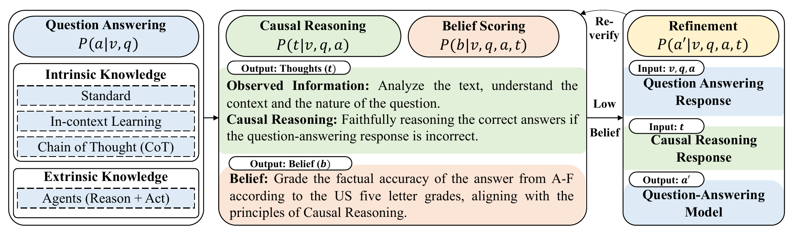

# CORE

Implementation of **Causal-driven Large Language Models with Faithful Reasoning for Knowledge Question Answering**, ACM MM 2024. [Paper](https://doi.org/10.1145/3664647.3681263)

CORE improves knowledge question answering through causal reasoning and belief-based refinement: generate an initial answer, evaluate its reasoning, refine when needed, and select the final answer after re-evaluation.

[](https://doi.org/10.1145/3664647.3681263)
*Figure 3. Overview of CORE.*

## Experiments

The same CORE workflow supports both benchmarks, comparing each baseline with its CORE-enhanced counterpart.

| Dataset | Answering methods | Evaluation |
| --- | --- | --- |
| [ScienceQA](https://github.com/lupantech/ScienceQA) | A / AE / ALE | Overall and subgroup accuracy |
| [HotpotQA](https://hotpotqa.github.io/) | Standard / zero-shot CoT / ReAct | EM, F1, model-judged accuracy, steps and token usage |

Public inputs are downloaded separately. Each run generates its own baseline and CORE responses and scores.

## Quick start

Use **Python 3.9+** and an OpenAI API key. No additional packages or GPU are required; ReAct also needs Wikipedia access. Run commands from `CORE/`, keeping data and results outside it.

```bash
export OPENAI_API_KEY="YOUR_OPENAI_API_KEY"
python3 -m unittest discover -s tests
```

### ScienceQA

Download annotations and image captions, run one question, and evaluate:

```bash
python3 tools/fetch_scienceqa.py --output-dir ../scienceqa --captions
python3 run_inference.py --data-root ../scienceqa --captions ../scienceqa/instruct_captions.json \
  --format ALE --limit 1 --output ../scienceqa_ALE_smoke.json
python3 evaluate_run.py ../scienceqa_ALE_smoke.json --data-root ../scienceqa
```

For full experiments, use `--full-test` instead of `--limit 1` and run each format: A, AE and ALE. Responses are saved as JSON; evaluation prints accuracy.

### HotpotQA

Download two questions and run all three methods:

```bash
python3 tools/fetch_hotpotqa.py --limit 2 --output ../hotpot_smoke.json
python3 run_hotpotqa.py --data ../hotpot_smoke.json --style all --sample-size 2 \
  --output ../hotpot_smoke_results.json
```

For larger experiments, download the full split with `--limit 0`, then choose `--sample-size` (for example, 1000). You can also supply **Dev set (fullwiki)** from the [official website](https://hotpotqa.github.io/) via `--data`. Results include per-method JSON/CSV files and an aggregate summary.

Default configurations: ScienceQA [A](configs/scienceqa_A.json) / [AE](configs/scienceqa_AE.json) / [ALE](configs/scienceqa_ALE.json), and [HotpotQA](configs/hotpotqa.json). Use each script's `--help` for options. Add `--dry-run` to validate inputs without model calls. Repeat the same command to resume, and use a new output file for changed settings or inputs. Live runs incur API charges, so start with a small sample.

The release implements the CORE workflow with documented settings. API models and live retrieval can change results; exact historical HotpotQA settings were not fully recovered. Source details are recorded in [PROVENANCE.json](PROVENANCE.json).

## Citation and license

If you use CORE, please cite [Wang et al., ACM MM 2024](https://doi.org/10.1145/3664647.3681263), *Causal-driven Large Language Models with Faithful Reasoning for Knowledge Question Answering*.

See [LICENSE](LICENSE) and [NOTICE.md](NOTICE.md) for licensing and attribution to datasets and upstream work.
